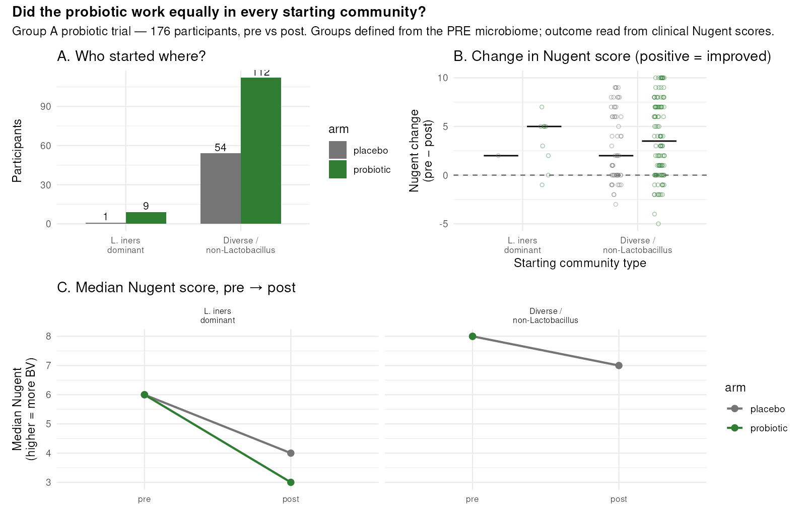

## The dataset: six files, three tables that belong together

- `01_metadata.csv` — one row per **sample** (352): who, when, which arm, clinical readings
- `02_microbiome_counts.csv` — 220 bacterial species × 352 samples, **raw counts**
- `03_microbiome_taxonomy.csv` — the family tree for each species
- `04_rnaseq_counts.csv.gz` — 14,226 human genes × 352 samples, **raw counts**
- `05_gene_annotation.csv` — gene ID → symbol → full name
- `06_cytokines.csv` — 18 immune-signalling proteins per sample

All three measurement tables use the **same 352 sample IDs**, verified to line up with the metadata.

## Who is in the trial?

| Arm | Participants | Samples (pre + post) |
|---|---|---|
| Probiotic | **121** | 242 |
| Placebo | **55** | 110 |
| Total | **176** | **352** |

- Two visits per person: **pre** and **post**
- Unbalanced by design: roughly 2 : 1 probiotic : placebo
- Sequencing ran in two batches (B1: 172 samples, B2: 180)

## QC check 1–2: do the tables line up, are the counts real counts?

- `identical(colnames(counts), metadata$sample_id)` → **TRUE** for both count tables
- Cytokine sample IDs: same set → **TRUE**
- All counts are **whole, non-negative, no missing values** — safe to feed DESeq2 raw

## QC check 3: library sizes — who has very few reads?

{width=90%}

- Microbiome median depth ≈ 33k reads; RNA-seq median ≈ 12.6 M reads
- **1 flag below 25% of median: `A116_pre` — only 604 microbiome reads** (its RNA-seq is normal)
- Watch-list: `A118_post` (8.3k reads, just above the cut-off)

## QC check 4–5: batch balance and baseline comparability

|  | B1 | B2 |
|---|---|---|
| placebo | 70 | 40 |
| probiotic | 102 | 140 |

- Batch vs time point: perfectly balanced (86/90 at both visits)
- **Batch vs arm: imbalanced** — RNA-seq arm comparisons must adjust for batch
- **Baseline: arms start alike** — age, pH, Nugent, amine, discharge all p > 0.5; both arms almost all BV-positive at entry

## Our question: did the probiotic only work in people whose community started a certain way?

- Each person labelled by their **pre** microbiome only:
  **L. crispatus dominant** (>50%), **L. iners dominant** (>50%), or **Diverse**
- Effect = change in **Nugent score** (pre − post; positive = improved)
- Key discipline: groups defined from the **microbiome** table, outcome read from the **clinical** table — never define and test in the same table

## What we found

{width=95%}

## The numbers, and the honest answer

| Starting community | n placebo | n probiotic | median ΔNugent placebo | median ΔNugent probiotic | Wilcoxon p |
|---|---|---|---|---|---|
| Diverse | 54 | 112 | 2.0 | 3.5 | 0.20 |
| L. iners dominant | 1 | 9 | 2.0 | 5.0 | 0.59 |
| L. crispatus dominant | **0** | **0** | — | — | — |

- **No starting type where the probiotic clearly worked** — but a consistent hint: more improvers on probiotic in both groups (73% vs 61%)
- **Nobody started crispatus-dominant**, so the "best" baseline can't be tested here
- The iners comparison rests on **1 placebo person** — not evidence

## Summary

1. The data is **clean enough to analyse**: tables align, counts are raw and whole, batch × time is balanced
2. Three things to carry forward: drop/handle **A116_pre** in microbiome analyses, **adjust for batch** in RNA-seq, and treat 2 missing Nugent scores consciously
3. The probiotic's effect did **not** concentrate in one starting community — hints only, no significance, and one stratum is empty
4. Group sizes are very unbalanced (121 vs 55) — small placebo strata will keep limiting us

## Choices made

- Grouping rule: >50% of one Lactobacillus species, from the **pre** sample only — alternative: unsupervised clustering
- Outcome: clinical Nugent change — alternative: microbiome change (rejected: same-table testing)
- Tests: Wilcoxon rank-sum, Fisher exact, no multiplicity correction (QC/look stage)
- Low reads: flagged below **25% of median** — alternative: fixed read count
- PDF via **typst** (no LaTeX in this Codespace); same figures in HTML and PPTX
