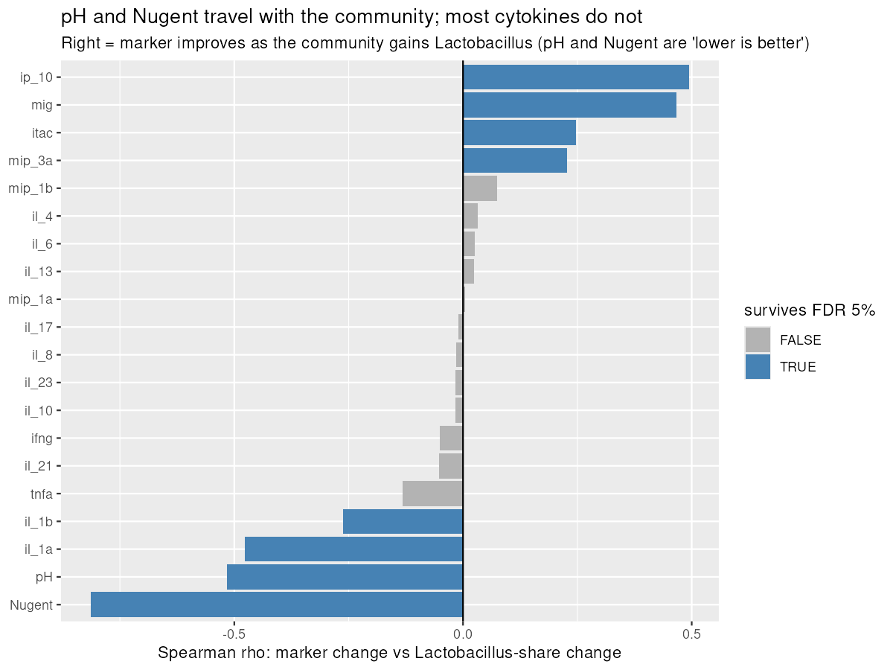

**The question.** Maybe the probiotic only helps if the vaginal community was
already in a state it can act on. To answer it we need three things:

1. **Where each person started** — their pre-visit community state.
2. **How they responded** — the change from pre to post.
3. A test of the **interaction**: does the probiotic–placebo *difference*
   change depending on the starting state?

**Design choice (the workshop rule).** The starting group is defined from the
**pre-visit Nugent score** (clinical metadata, 0–10, 7+ = BV), and the
response is measured in the **microbiome count table** — so the group and the
tested table come from different sources. Note this trial enrolled only
people with an abnormal Nugent score (everyone ≥ 4 at pre), so the baseline
states are "intermediate (4–6)" vs "BV (7–10)".

```{r setup, message=FALSE}
library(dplyr)
library(tidyr)
library(ggplot2)

source(here::here("R/count_tables.R"))
d <- read_counts("group_a")
m <- d$metadata

# Relative abundance of all Lactobacillus species per sample.
# (Compositional: it says "share of the reads", not "amount of bacteria".)
rel   <- sweep(d$species, 2, colSums(d$species), "/")
lacto <- colSums(rel[grep("^lactobacillus", rownames(rel)), , drop = FALSE])

# One row per PERSON: pre values joined to post values.
pre  <- filter(m, time_point == "pre")
post <- filter(m, time_point == "post")
people <- pre |>
  transmute(participant_id, arm,
            nugent_pre = nugent, lacto_pre = lacto[sample_id]) |>
  left_join(post |> transmute(participant_id,
            lacto_post = lacto[sample_id], nugent_post = nugent),
            by = "participant_id") |>
  mutate(
    delta = lacto_post - lacto_pre,
    base  = cut(nugent_pre, c(-1, 6, 10),
                labels = c("intermediate (4-6)", "BV (7-10)"))
  )
```

# Plot 1 (barchart): who returned to a normal Nugent score?

"Cured" = Nugent back to ≤ 3 at the post visit. Bars show the percentage,
with the actual counts printed on top.

```{r}
#| label: barchart
cure <- people |>
  # No post Nugent score -> counted as NOT cured (conservative, keeps everyone).
  mutate(cured = !is.na(nugent_post) & nugent_post <= 3) |>
  group_by(arm, base) |>
  summarise(n = n(), cured_n = sum(cured), rate = cured_n / n, .groups = "drop")

p1 <- ggplot(cure, aes(base, rate, fill = arm)) +
  geom_col(width = 0.6, position = position_dodge(0.65)) +
  geom_text(aes(label = paste0(cured_n, "/", n)),
            position = position_dodge(0.65), vjust = -0.3, size = 3.5) +
  scale_fill_manual(values = c(placebo = "grey60", probiotic = "steelblue")) +
  labs(y = "proportion with post Nugent <= 3",
       x = "community state at the pre visit", fill = NULL,
       title = "Return to a normal Nugent score, by arm and starting state") +
  ylim(0, 0.75)
p1
ggsave(here::here("group_project/04-baseline-barchart.png"), p1,
       width = 7, height = 5, dpi = 150)
```

# Plot 2 (boxplot): change in Lactobacillus share

Each point is a person: how much the *Lactobacillus* share of the reads moved
between visits. The boxplot shows the spread.

```{r}
#| label: boxplot
p2 <- ggplot(people, aes(base, delta, fill = arm)) +
  geom_boxplot(width = 0.6, position = position_dodge(0.65), outlier.shape = NA) +
  geom_point(position = position_jitterdodge(jitter.width = 0.15, dodge.width = 0.65),
             alpha = 0.35, size = 1.2) +
  geom_hline(yintercept = 0, linetype = "dashed") +
  scale_fill_manual(values = c(placebo = "grey60", probiotic = "steelblue")) +
  labs(y = "change in Lactobacillus share (post minus pre)",
       x = "community state at the pre visit", fill = NULL,
       title = "Everyone drifts upward - the question is whether arms differ by starting state")
p2
ggsave(here::here("group_project/04-baseline-boxplot.png"), p2,
       width = 7, height = 5, dpi = 150)
```

# Plot 3 (trajectories): group means, pre to post

The interaction, seen directly: each line is a group mean moving from pre to
post. Parallel lines = no interaction (the probiotic gap is the same wherever
you started).

```{r}
#| label: trajectories
means <- people |>
  group_by(arm, base) |>
  summarise(pre = mean(lacto_pre), post = mean(lacto_post), .groups = "drop") |>
  pivot_longer(c(pre, post), names_to = "visit", values_to = "lacto") |>
  mutate(visit = factor(visit, c("pre", "post")))

p3 <- ggplot(means, aes(visit, lacto, colour = arm, group = arm)) +
  geom_line(linewidth = 1) +
  geom_point(size = 3) +
  facet_wrap(~base) +
  scale_colour_manual(values = c(placebo = "grey40", probiotic = "steelblue")) +
  labs(y = "mean Lactobacillus share of reads", x = NULL, colour = NULL,
       title = "Group-mean trajectories: the lines are close to parallel",
       subtitle = "A big gap between arms at one starting state but not the other would suggest an interaction")
p3
ggsave(here::here("group_project/04-baseline-trajectories.png"), p3,
       width = 7, height = 5, dpi = 150)
```

# The test

A linear model of the Lactobacillus change. The line we care about is
`arm:base` — the interaction. A small p-value there would mean "the probiotic
effect depends on the starting state".

```{r}
#| label: test
fit <- lm(delta ~ arm * base, data = people)
anova(fit)
```

And the same question asked about "cure" (binary), stratified by starting
state, plus overall:

```{r}
#| label: fisher
cure2 <- people |> mutate(cured = !is.na(nugent_post) & nugent_post <= 3)
cat("Overall cure: probiotic",
    sum(cure2$cured[cure2$arm == "probiotic"]), "/",
    sum(cure2$arm == "probiotic"),
    "  placebo", sum(cure2$cured[cure2$arm == "placebo"]), "/",
    sum(cure2$arm == "placebo"), "\n")
cat("Overall Fisher p:",
    fisher.test(cure2$cured, cure2$arm)$p.value, "\n\n")
cure2 |> group_by(base) |>
  group_map(~ cat("Baseline", as.character(.y), ": Fisher p =",
                  fisher.test(.x$cured, .x$arm)$p.value, "\n"))
```

# Verdict

**No good evidence that the probiotic only worked in one starting state.**

- The interaction test gives p = 0.91 (baseline as two groups) and p = 0.72
  (baseline as the raw 0–10 score, not shown) — nothing close to significant.
- The trajectories plot shows near-parallel lines.
- What *does* matter is the starting state itself (p = 0.003): people who
  started worse gained more *Lactobacillus* — but that happened in the
  **placebo arm too**, which smells like regression to the mean plus
  spontaneous recovery, not a probiotic effect.
- The probiotic arm cures more often overall (44% vs 31%, Fisher p = 0.13) —
  a hint of an overall effect, spread across both starting states, but not
  statistically significant on its own in this sample.

**Caveats:** cells are unbalanced (only 3 placebo participants started
intermediate); Lactobacillus share is compositional, so "share went up" is
not "there was more"; and 2 participants have no post Nugent score
(A128_post, A135_post) — they are counted as not cured, a conservative
choice that slightly *shrinks* the probiotic arm's rate.

**How to check me yourself:** in the barchart, read the counts on the
probiotic bars — 5/12 and 48/109 — and compare with
`table(m$arm[m$time_point=="pre"], m$nugent[m$time_point=="pre"] > 6)`
computed by hand. If the bar chart counts disagree with that table, I made a
join mistake.

# Follow-up question: do pH, Nugent and cytokines move with the community change?

*(Full report: `08-covariation.html` — this is the short version.)*

Everyone improved on average between the visits, so we asked a second
question: when a person's **community** changed, did the clinical and immune
markers move **with** it, or on their own? For each person we took the
pre→post change of pH, Nugent and all 18 cytokines, and correlated those
changes with the community change (Lactobacillus-share change and the
Bray–Curtis distance between a person's pre and post samples). Spearman
correlations, BH-corrected across the 20 markers.



**Answer:**

- **Nugent moves with the community, overwhelmingly** — rho = −0.81 with the
  Lactobacillus change, −0.71 with the overall Bray–Curtis move (expected:
  the Nugent score grades the community).
- **pH moves with it too** — rho = −0.52: more Lactobacillus, lower pH.
  pH and Nugent changes also track each other (rho = 0.49).
- **IL-1β weakly with it** (rho = −0.26, survives the correction).
- **IP-10 moves with it but the "wrong" way** — rho = +0.49, and it *rises*
  on average (p ≈ 1e-7) while everything else calms down.
- **IL-8, IL-6, TNFα, MIP-1α and the rest move on their own** — near-zero
  correlations; IL-8 does not even change on average (p = 0.81).

Caveat: correlated changes cannot prove which is driving which.

## Choices made

- Baseline state from the pre-visit **Nugent score** (clinical metadata);
  alternative not chosen: classify the pre-visit community from the
  microbiome table itself (more direct, but it would define the group from
  the same table we test).
- Response measured as the change in **total Lactobacillus relative
  abundance**; alternatives not chosen: change in *L. crispatus* alone, or
  alpha diversity.
- "Cured" defined as post Nugent ≤ 3; alternative not chosen: Nugent drop of
  ≥ 4 points.
- Test: `lm(delta ~ arm * base)` interaction with `anova`; alternatives not
  chosen: DESeq2 on the post counts (no clean pre/post pairing in that
  design), or a logistic interaction model (cells too small).
- Counted the 2 participants with a missing post Nugent score as "not
  cured" (conservative, keeps everyone); alternative not chosen: exclude
  them, which gives a slightly higher probiotic cure rate.
- Kept the shallow sample A116_pre (604 reads); alternative not chosen:
  drop it and re-run as a sensitivity check.
- No batch term in the model (batch B1/B2 is a sequencing label, unlikely to
  shift Nugent or the Lactobacillus share much); alternative: add
  `rnaseq_batch`.
- The follow-up section above is a summary of `08-covariation.html`, whose
  own *Choices made* section documents that analysis (paired-change design,
  Spearman with BH correction, Bray–Curtis on relative abundance, missing
  values left missing); alternative not chosen: repeat the full analysis
  here.
