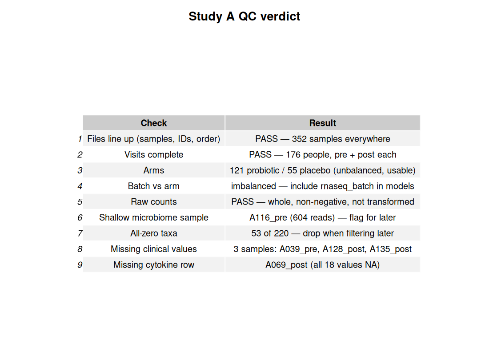
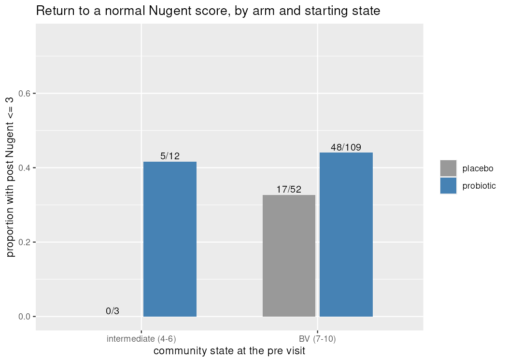
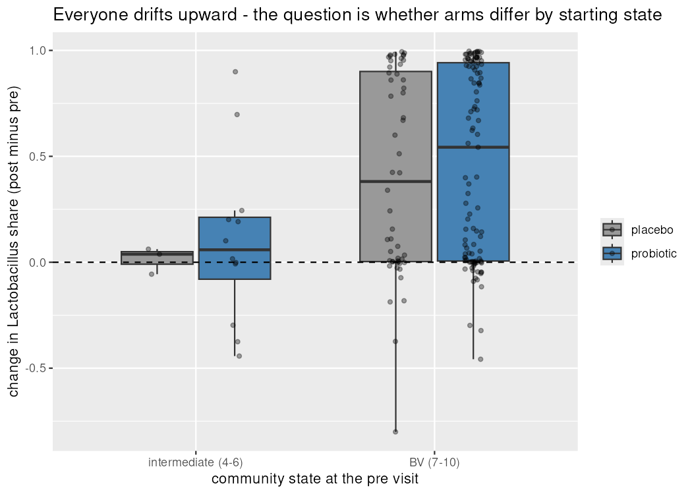
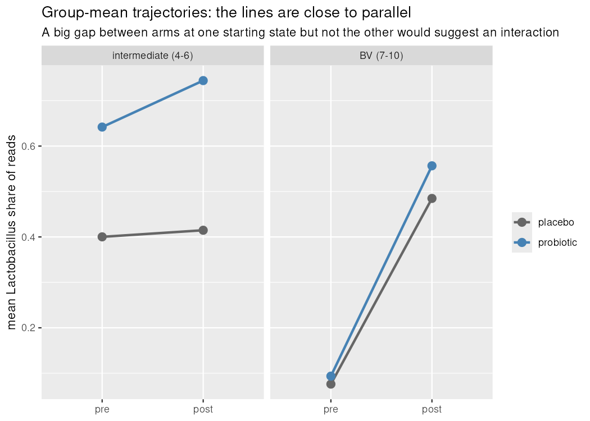

# One-paragraph answer

We asked whether the probiotic only worked in people whose vaginal community
started a certain way. **It did not** — the interaction between arm and
starting state was nowhere near significant (p = 0.91). The probiotic arm did
slightly better overall (44% vs 31% returned to a normal Nugent score,
p = 0.13 — a hint, not proof), and that small advantage looked the same in
people who started intermediate (Nugent 4–6) and people who started with BV
(Nugent 7–10). People who started worse improved more in *both* arms, which
is mostly regression to the mean plus natural recovery, not a drug effect.

# 1. The data at a glance

Three datasets in `data/2-workshop2/`, all with the same six files. Both
count tables have **features in rows, samples in columns**, and raw counts
only (what DESeq2 wants).

```{r setup, message=FALSE}
library(dplyr)
library(knitr)
source(here::here("R/count_tables.R"))
```

```{r}
#| label: datasets
datasets <- tibble::tribble(
  ~Dataset, ~People, ~Arms, ~Samples,
  "instructional (pregnancy)", "157", "term 114 / preterm 43", "471 (3 visits)",
  "group A — probiotic trial",  "176", "probiotic 121 / placebo 55", "352 (pre + post)",
  "group B — contraception",    "93",  "pill 28 / injectable 39 / ring 26", "93"
)
kable(datasets, caption = "People per arm in each dataset")

files <- tibble::tribble(
  ~File, ~Contents,
  "01_metadata.csv", "One row per sample: who, when, arm, clinical measurements",
  "02_microbiome_counts.csv", "220 taxa x samples, raw counts",
  "03_microbiome_taxonomy.csv", "Domain ... species for each taxon",
  "04_rnaseq_counts.csv.gz", "14,226 genes x samples, raw counts",
  "05_gene_annotation.csv", "Ensembl id, symbol, name, type per gene",
  "06_cytokines.csv", "Cytokine concentrations per sample"
)
kable(files, caption = "The six files in every dataset (identical structure)")
```

The rest of this report is about **Study A**, the probiotic trial.

# 2. Data quality (full report: 01-qc.html)

```{r}
#| label: qc
qc <- tibble::tribble(
  ~Check, ~Result,
  "Files line up (samples, IDs, order)", "PASS — 352 samples everywhere",
  "Visits complete", "PASS — 176 people, pre + post each",
  "Arms", "121 probiotic / 55 placebo (unbalanced, usable)",
  "Batch vs arm", "imbalanced — include rnaseq_batch in models",
  "Raw counts", "PASS — whole, non-negative, not transformed",
  "Shallow microbiome sample", "A116_pre (604 reads) — flagged",
  "All-zero taxa", "53 of 220 — drop when filtering later",
  "Missing clinical values", "3 samples: A039_pre, A128_post, A135_post",
  "Missing cytokine row", "A069_post (all 18 values NA)"
)
kable(qc, caption = "QC verdict (details in 01-qc.html)")
```



# 3. Did the probiotic only work in people whose community started a certain way?

**Design.** Starting state = pre-visit **Nugent score** (clinical metadata —
the trial only enrolled people with an abnormal score, so the states are
*intermediate 4–6* vs *BV 7–10*). Response = change in the **microbiome
count table** (Lactobacillus share of reads, and "cured" = post Nugent ≤ 3).
Group from the clinical table, test the count table — the workshop rule.







**What the plots say:** cure rates are a bit higher in the probiotic arm in
both starting states (48/109 vs 17/52 among BV starters; 5/12 vs 0/3 among
the very few intermediate placebo starters), the boxplots overlap heavily,
and the trajectory lines are nearly parallel — no interaction.

**What the tests say:**

```{r}
#| label: analysis-numbers
d <- read_counts("group_a")
rel <- sweep(d$species, 2, colSums(d$species), "/")
lacto <- colSums(rel[grep("^lactobacillus", rownames(rel)), , drop = FALSE])
pre  <- filter(d$metadata, time_point == "pre")
post <- filter(d$metadata, time_point == "post")
people <- pre |>
  transmute(participant_id, arm, nugent_pre = nugent,
            lacto_pre = lacto[sample_id]) |>
  left_join(post |> transmute(participant_id, lacto_post = lacto[sample_id],
                              nugent_post = nugent), by = "participant_id") |>
  mutate(delta = lacto_post - lacto_pre,
         base = cut(nugent_pre, c(-1, 6, 10),
                    labels = c("intermediate (4-6)", "BV (7-10)")))

fit <- lm(delta ~ arm * base, data = people)
p_int  <- anova(fit)["arm:base", "Pr(>F)"]
p_base <- anova(fit)["base", "Pr(>F)"]

cure2 <- people |>
  mutate(cured = !is.na(nugent_post) & nugent_post <= 3)
p_cure <- fisher.test(cure2$cured, cure2$arm)$p.value

results <- tibble::tribble(
  ~Question, ~Answer, ~"p-value",
  "Does the probiotic effect depend on the starting state?",
  "No — the interaction is essentially zero", sprintf("%.2f", p_int),
  "Does the starting state predict change at all?",
  "Yes — worse starters improve more, in BOTH arms", sprintf("%.3f", p_base),
  "Does the probiotic cure more people overall?",
  "A hint (44% vs 31%), not significant", sprintf("%.2f", p_cure)
)
kable(results, caption = "Summary of the three statistical tests")
```

**Caveats worth remembering:** only 3 placebo participants started
intermediate, so that cell says almost nothing; Lactobacillus share is
compositional ("share went up" is not "there was more"); and 2 participants
with a missing post Nugent score were counted as not cured (conservative).
"Absence of evidence" is not "evidence of absence" — a bigger placebo arm
could still reveal a real interaction.

# 4. If we continue

- Re-run the cure comparison with a proper logistic model including
  `rnaseq_batch`, or a paired DESeq2 on the post-visit counts.
- Sensitivity check: drop the shallow sample A116_pre and see whether any
  conclusion moves.
- Ask the same question with the **other** tables — e.g. does the cytokine
  response (a different table) depend on the microbiome starting state?

## Choices made

Every decision behind this report, with the reason and the alternative we did
**not** choose.

### Loading the data

- **Loaded with `read_counts("group_a")` (the workshop helper)** — it also
  re-orders the count-table columns to match the metadata rows. Alternative
  not chosen: `read.csv` by hand, where a silent column-order mismatch would
  corrupt every test.
- **Kept the counts raw** (whole numbers, nothing normalised or logged) —
  DESeq2 requires raw counts if we use it later. Alternative not chosen:
  pre-normalise to CPM, which would break DESeq2.
- **Turned counts into relative abundance (share of a sample's reads)** for
  the Lactobacillus outcome — share of the reads, not absolute amount
  (both tables are compositional). Alternative not chosen: a CLR transform,
  which handles compositionality properly but is harder to read on a plot.

### Quality-check decisions

- **QC only — nothing dropped** at the QC stage (A116_pre, A069_post only
  flagged). Alternative not chosen: drop problem samples immediately, before
  anyone decided what the analysis would be.
- **Shallow-sample threshold fixed at 5,000 reads** — flagged A116_pre
  (604 reads). Alternative not chosen: a quantile-based cut-off, which
  depends on the dataset and is harder to defend.
- **53 all-zero taxa counted but not removed** — filtering belongs to the
  analysis, where DESeq2 or a prevalence filter can do it in context.
  Alternative not chosen: delete them during QC.
- **Verified counts are whole and non-negative** instead of trusting the
  file names to mean "raw counts".
- **Reported the batch–arm imbalance** (placebo 70/40 vs probiotic 102/140
  across B1/B2) and kept `rnaseq_batch` as a candidate covariate.
  Alternative not chosen: ignore it.
- **Missing values reported, never imputed** — 3 samples with a missing
  clinical value (A039_pre, A128_post, A135_post), and a cytokine "sample"
  called missing only when the whole row is NA (A069_post). Alternative not
  chosen: fill gaps in, which invents data.

### Analysis decisions

- **Baseline state = pre-visit Nugent score, two groups (4–6, 7–10)** —
  everyone enrolled had an abnormal score, so "normal" was an empty group.
  The group comes from the clinical metadata, the tested outcome from the
  count table — the workshop rule. Alternative not chosen: classify the
  starting community from the microbiome table itself (would define the
  group from the same table we test).
- **Interaction tested two ways** — baseline as two groups (p = 0.91) and as
  the raw 0–10 score (p = 0.72, mentioned in 04-baseline-response.html).
  Alternative not chosen: three Nugent levels (intermediate cells are too
  small: 3 placebo people).
- **Outcome 1: change in total Lactobacillus share (all 10 species summed,
  post minus pre)** — a paired within-person change, which removes each
  person's starting level. Alternative not chosen: change in *L. crispatus*
  alone, or alpha diversity (both sensible follow-ups).
- **Outcome 2: "cured" = post Nugent ≤ 3** — the standard cure definition.
  Alternative not chosen: "Nugent dropped by 4+ points", which also counts
  people who improve without reaching normal.
- **Interaction test: `lm(delta ~ arm * base)` with `anova`** — the
  arm:base line answers the question directly. Alternatives not chosen:
  DESeq2 on post counts (no clean pre/post pairing in that design), or a
  logistic interaction model (cells too small).
- **Cure comparison: Fisher's exact test**, overall and within each starting
  state — safe with small counts. Alternative not chosen: chi-square
  (approximation is poor in the small cells).
- **2 participants with a missing post Nugent score counted as NOT cured**
  (conservative, keeps everyone; slightly shrinks the probiotic rate).
  Alternative not chosen: exclude them — that raises the probiotic cure rate
  to 53/119 and would look better for the probiotic, so the conservative
  rule is the honest one.
- **Shallow sample A116_pre kept in the analysis** — alternative not chosen:
  drop it and re-run as a sensitivity check (listed under "if we continue").
- **No batch term in the model** — `rnaseq_batch` labels sequencing runs and
  is unlikely to shift Nugent or the Lactobacillus share much. Alternative
  not chosen: add it (sensible once cells are bigger).

### Plot decisions

- **Barchart: cure rate with raw counts printed on the bars** (e.g. 48/109)
  so small cells cannot hide behind a tall bar. Alternative not chosen:
  percentages only.
- **Boxplot: outliers hidden, every person shown as a jittered point** — the
  points are the truth, the box is just a summary. Alternative not chosen:
  boxplot with default outlier dots (double-draws the same people).
- **Third plot: group-mean trajectories (pre → post lines)** — parallel
  lines = no interaction, which is exactly our question. Alternative not
  chosen: a pre-vs-post scatter, which shows the same thing but is harder
  to read per group.
- **Trajectory y-axis on the 0–1 relative-abundance scale**, not counts —
  same reasoning as the compositional choice above.

### Reporting decisions

- **One separate final document** (this one) instead of editing the earlier
  reports — 01-qc.html and 04-baseline-response.html stay as they were.
- **All statistics recomputed live** when this document renders, so the
  numbers cannot drift from the data. Alternative not chosen: paste in
  numbers from the earlier reports.
- **Re-used the saved plot PNGs** instead of re-plotting — the figures are
  identical to the ones documented in 04-baseline-response.html.
