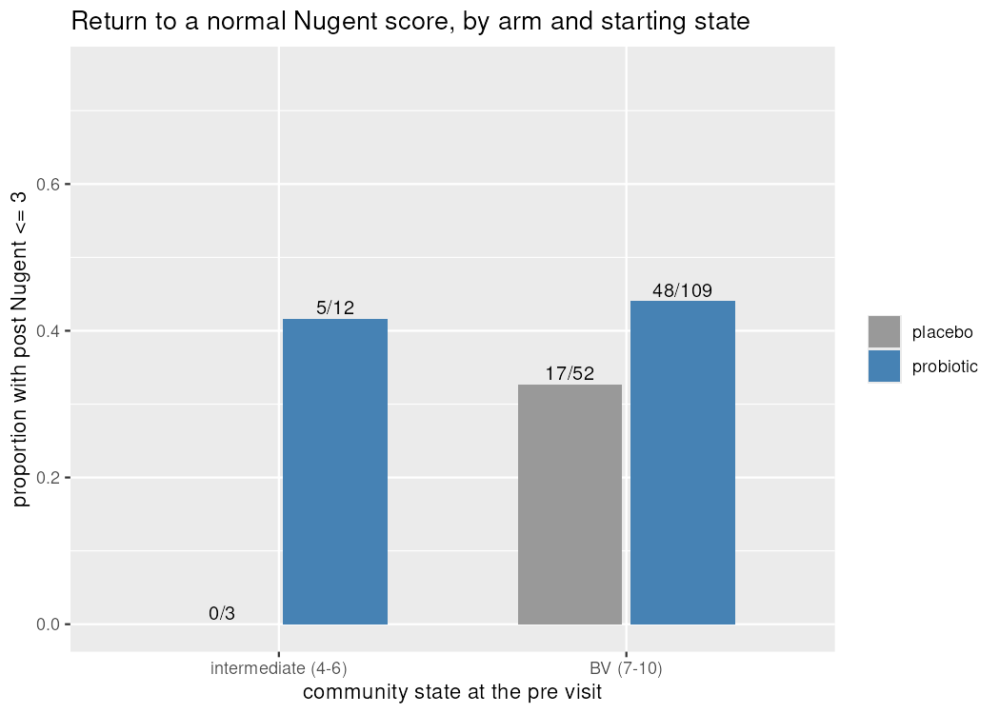
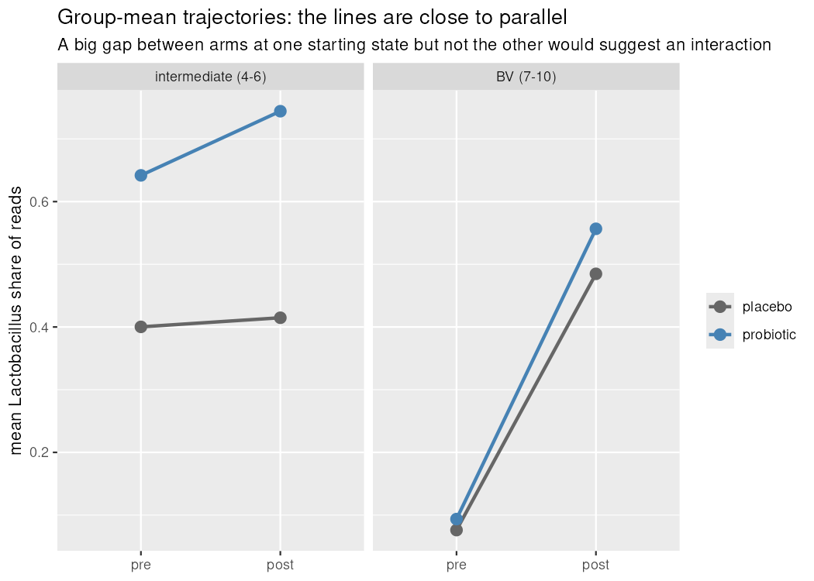

## The question and the design

**Did the probiotic only work in people whose community started a certain way?** *(Study A — 176 people, pre and post visits)*

- **Study A:** probiotic trial, 176 people (121 probiotic / 55 placebo), swabs before and after
- **Question:** did the probiotic only help people whose vaginal community *started* in a certain state?
- **Starting state:** pre-visit Nugent score — everyone enrolled was abnormal (4+), so states are *intermediate (4–6)* vs *BV (7–10)*
- **Response:** change in the Lactobacillus share of reads, and "cured" = post Nugent ≤ 3
- **Workshop rule kept:** group defined from the clinical metadata, response tested in the count table

## The result: no interaction

- Interaction test **p = 0.91** (baseline as two groups) and **p = 0.72** (raw 0–10 score)
- Cure rates: probiotic a bit higher in *both* starting states — the advantage does not depend on where you started
- Starting worse predicts improvement in *both* arms (p = 0.003) — regression to the mean, not a drug effect

## Verdict, caveats, next steps

- **No evidence the probiotic only worked in one starting state** — near-parallel trajectories in every view of the data
- Overall cure: **44% vs 31%** (Fisher p = 0.13) — a hint of an overall effect, not significant on its own
- **Caveats:** only 3 placebo participants started intermediate; Lactobacillus share is compositional; 2 missing post scores counted as not cured (conservative)
- **Next:** logistic model with sequencing batch; sensitivity check without the shallow sample A116_pre; same question against the cytokine table

