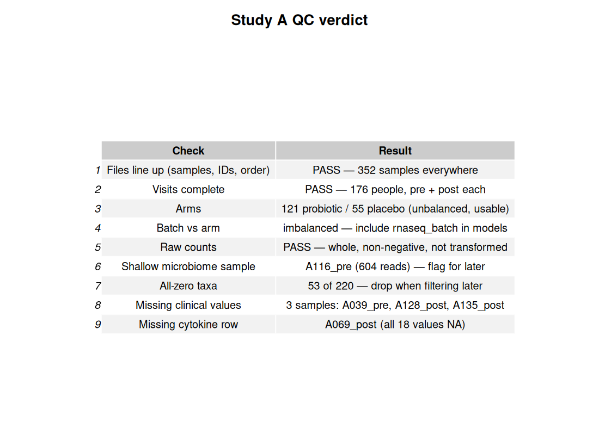
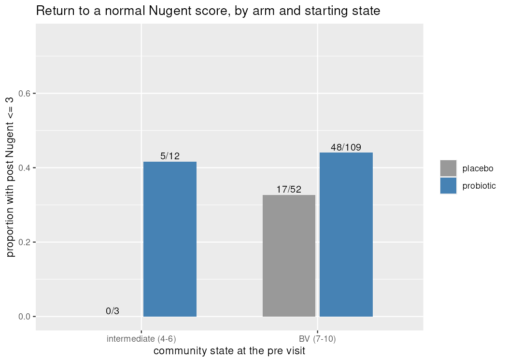
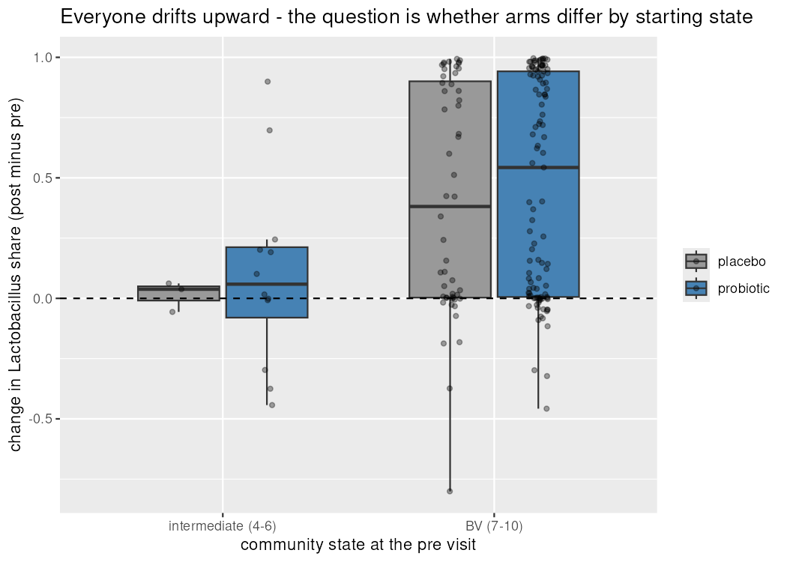
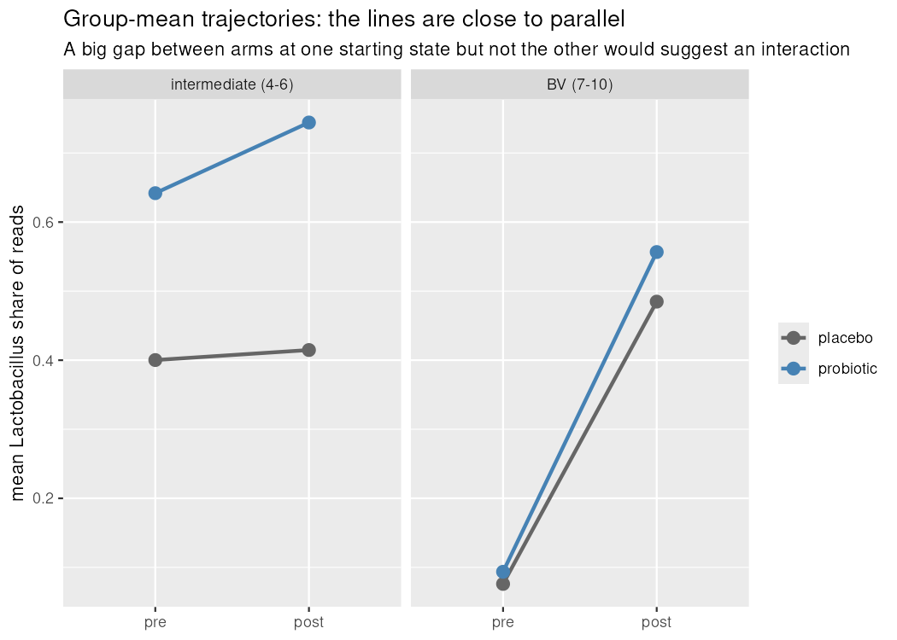

## Today's session in one slide

**Data overview → quality checks → analysis → summary**

- Looked inside all three workshop datasets (files, arms, columns)
- Wrote and ran a quality check of Study A (the probiotic trial)
- Asked: *did the probiotic only work in people whose community started a certain way?* — and tested it
- Everything below is also written up as HTML + PDF reports in `group_project/`
- Every decision behind the numbers (19 of them) is documented in the final summary's *Choices made* section

## The data at a glance

| Dataset | People | Arms | Samples |
|---|---|---|---|
| instructional (pregnancy) | 157 | term 114 / preterm 43 | 471 (3 visits) |
| **group A — probiotic** | **176** | **probiotic 121 / placebo 55** | **352 (pre + post)** |
| group B — contraception | 93 | pill 28 / injectable 39 / ring 26 | 93 |

Every dataset has the same six files; both count tables are **features in rows, samples in columns**, raw counts only

## Study A quality check — verdict

- Data in good shape: no duplicates, complete visits, counts genuinely raw
- Three things to remember: shallow sample **A116_pre**, missing cytokine row **A069_post**, **batch–arm imbalance** (include `rnaseq_batch` in models)

## The question and the design

**Did the probiotic only work in people whose community started a certain way?**

- Starting state: **pre-visit Nugent score** — everyone enrolled was abnormal (4+), so *intermediate (4–6)* vs *BV (7–10)*
- Response: change in the **Lactobacillus share of reads** (microbiome table) and "cured" = post Nugent ≤ 3
- Workshop rule kept: group from the clinical metadata, test the count table

## Result 1 — cure rates by starting state

- Probiotic a bit higher in **both** starting states (48/109 vs 17/52; 5/12 vs 0/3)
- Interaction (arm × starting state): **p = 0.91** — no evidence the effect depends on where you started

## Result 2 — change in Lactobacillus share

- Distributions overlap heavily in every group
- Starting worse predicts improvement in **both arms** (p = 0.003) — regression to the mean, not a drug effect

## Result 3 — group-mean trajectories

- Near-parallel lines in both panels = no interaction
- Overall cure: **44% vs 31%** (Fisher p = 0.13) — a hint of an overall effect, not significant on its own

## Verdict and caveats

**No evidence the probiotic only worked in one starting state**

- Interaction p = 0.91 (two groups) and p = 0.72 (raw 0–10 score)
- Caveats: only 3 placebo participants started intermediate; Lactobacillus share is compositional; 2 missing post scores counted as not cured (conservative)
- Next: logistic model with batch; sensitivity check without A116_pre; same question against the cytokine table

## Everything we produced today

| Artifact | File |
|---|---|
| Dataset overview image | `data/2-workshop2/dataset_overview.png` |
| QC report | `group_project/01-qc.html` (+ verdict PNG) |
| Analysis report | `group_project/04-baseline-response.html` (+ 3 plot PNGs) |
| Final summary | `group_project/05-final-summary.html` + `.pdf` |
| This slide deck | `group_project/06-results-slides.pptx` (3 slides) |
